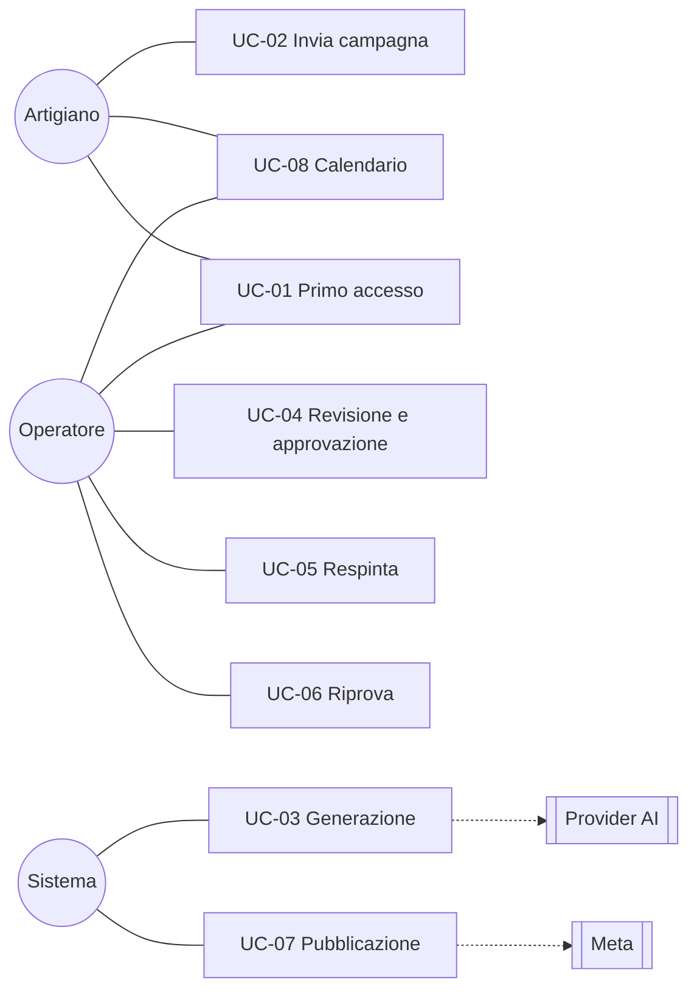
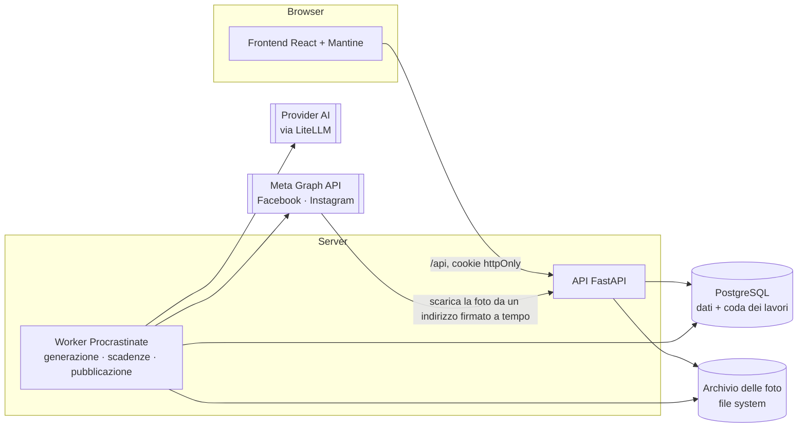
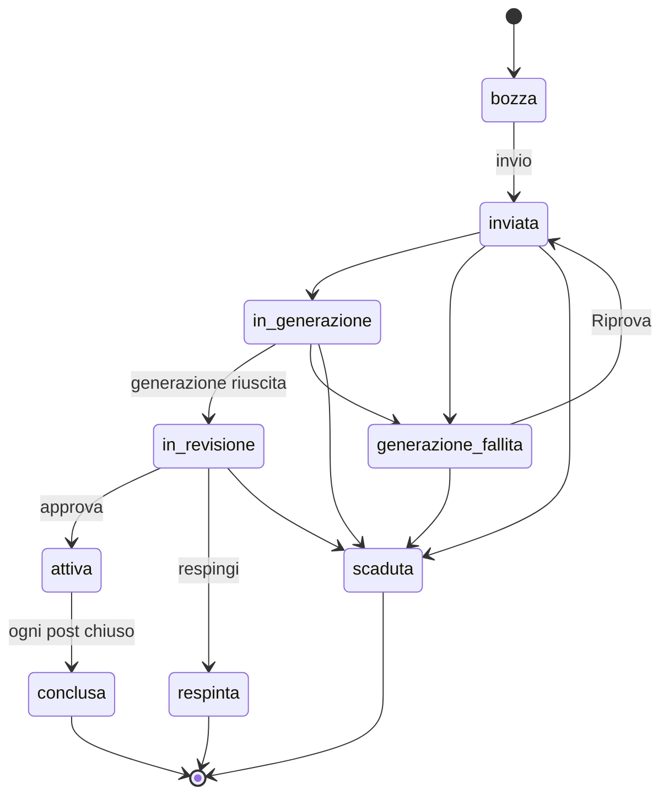
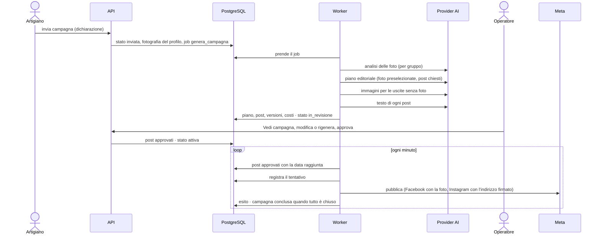
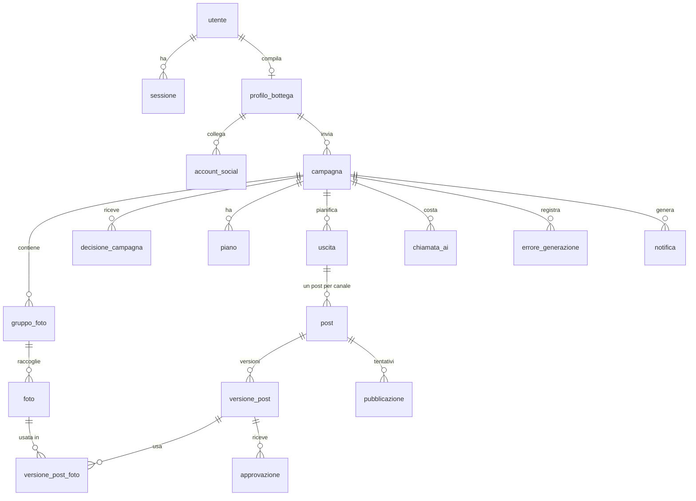

# AdFlow Suite · Proposta tecnica

**Per**: Consorzio degli artigiani · **Da**: team AdFlow (Gianluca, Silvia, Giovanni, Nilton, Angelo)
**Versione**: 0.9, bozza del 14/10/2026 · **Perimetro**: MVP del 6 novembre 2026 (ADR-114)
**Responsabili dei capitoli**: da assegnare · **Riletta da**: da assegnare

> Le voci segnate **[da confermare]** sono stime: le ore reali del team, la tariffa oraria e i costi dell'AI misurati con la prova su 10 post (T3-32, entro il 20/10) le sostituiscono prima della consegna. L'elenco completo è in fondo, in [Cosa resta da confermare](#cosa-resta-da-confermare).

## Sommario

AdFlow Suite aiuta un consorzio di botteghe artigiane a tenere vive le pagine Facebook e Instagram di ogni bottega senza chiedere all'artigiano di diventare un social media manager. L'artigiano compila una volta il profilo della bottega e, quando vuole un periodo di pubblicazioni, invia una campagna: date, canali e, se le ha, qualche foto con una descrizione. L'intelligenza artificiale valuta le foto, prepara il piano editoriale, scrive i testi e crea un'immagine per i post che le foto non coprono. Un operatore del consorzio rivede tutto, sistema ciò che non va e approva; da lì i post escono da soli, alla loro data, sulla pagina della bottega.

L'MVP consegnato il 6 novembre mostra questo percorso dal vivo, con l'AI vera e la pubblicazione reale su una pagina Facebook e Instagram di prova. Ciò che non serve alla dimostrazione è nella roadmap (capitolo 3.7).

---

## 1. Analisi dei requisiti

### 1.1 Il problema e l'obiettivo

Un artigiano sa fare il suo mestiere e lo sa raccontare a voce, ma raramente ha tempo e metodo per pubblicare con costanza: le pagine restano ferme per settimane, poi escono tre post in un giorno. Il consorzio può aiutare, ma scrivere a mano i post di decine di botteghe non è sostenibile.

**Obiettivo dell'MVP.** Dimostrare che, partendo dal profilo della bottega e da poche foto, il sistema produce un piano di post coerente con la bottega, che un operatore rivede in pochi minuti e che esce davvero sui social alla data prevista.

**Misura del risultato** (pitch e demo): una campagna di 7 giorni su due canali, inviata con meno foto dei post chiesti, arriva in revisione completa (post per canale uguali a quelli chiesti, immagini AI dove mancano le foto), viene approvata e pubblicata sulla pagina di prova; il costo AI della campagna è visibile.

### 1.2 Attori

| Attore | Chi è | Cosa fa nell'MVP |
|---|---|---|
| **Artigiano** | Il titolare o referente della bottega | Compila il profilo della bottega (9 passi); crea e invia campagne con canali e, se vuole, foto a gruppi; conferma la dichiarazione sulle foto; vede l'esito e, dopo l'approvazione, il calendario dei post |
| **Operatore** | Personale del consorzio | Rivede le campagne in arrivo; sistema i testi (a mano o facendoli riscrivere all'AI); approva o respinge; fa ripartire una generazione fallita; crea i nuovi artigiani |
| **Admin** | Responsabile tecnico del consorzio | Crea gli operatori da riga di comando; nelle pagine vale come un operatore |
| **Sistema** | Il worker in background | Genera le campagne con l'AI, applica le scadenze, pubblica i post alla loro data |
| **Servizi esterni** | Provider AI (tramite LiteLLM), Meta (Facebook e Instagram) | Analisi, testi e immagini; pubblicazione |

Un solo consorzio; canali Facebook e Instagram, solo foto.

### 1.3 Requisiti funzionali

Ogni requisito rimanda alle regole di dettaglio (R-xx) e ai criteri di accettazione (CA-xx) della specifica del progetto, che hanno un test automatico ciascuno.

| ID | Requisito | Regole | Criteri |
|---|---|---|---|
| RF-01 | Accesso con email e password; dopo l'accesso ognuno arriva alla sua pagina; la sessione scade dopo un periodo senza uso (7 giorni artigiano, 12 ore operatore) | R-29 | CA-01…03, CA-61…63 |
| RF-02 | L'operatore crea un artigiano con email e nome; la password provvisoria si mostra una sola volta | R-37 | CA-79 |
| RF-03 | Profilo della bottega in 9 passi, compilato una volta e confermato ai rientri; obbligatori segnalati | R-10 | CA-05…07 |
| RF-04 | Campagna in bozza: titolo, periodo (inizio ≥ oggi + 3 giorni, da 7 a 92 giorni), canali collegati, descrizione; una sola bozza; periodi non sovrapposti | R-08, R-12, R-22 | CA-08…12, CA-48 |
| RF-05 | Foto a gruppi con descrizione, facoltative: controllo di tipo, peso (≤ 10 MB) e lato corto (≥ 1080 px) | R-13 | CA-13 |
| RF-06 | Riepilogo con avvisi che non bloccano (foto poche, con il numero dei post che avranno un'immagine AI; frequenza alta) | R-25 | CA-54 |
| RF-07 | Invio con dichiarazione obbligatoria sulle foto; all'invio si salva la fotografia del profilo, che la generazione userà sempre | R-11, R-41 | CA-14…16 |
| RF-08 | Generazione a tappe: analisi delle foto (idoneità, doppioni, punteggio), piano con i post chiesti per canale, foto migliori per punteggio, immagini AI per i post scoperti, testi validati | R-05, R-09, R-21, R-24, R-28, R-43 | CA-17…20, CA-57, CA-80 |
| RF-09 | Errori dell'AI classificati in cinque tipi, con nuove esecuzioni automatiche o fermo in "generazione fallita" e Riprova dell'operatore | R-35 | CA-19, CA-50, CA-58…60, CA-68 |
| RF-10 | Revisione: elenco delle campagne da approvare per urgenza; Vedi campagna con piano, uscite, post affiancati per canale, blocchi e avvisi del validatore, costo AI | R-14, R-38, R-44 | CA-21, CA-69, CA-82 |
| RF-11 | Interventi sul post: modifica a mano (nuova versione con autore, validata) e rigenerazione del testo (3 per post) | R-02…04, R-30, R-31 | CA-26…28, CA-64, CA-66 |
| RF-12 | Decisione sulla campagna: approva in blocco (mai con un post bloccato) o respingi con motivo, nota e foto da rifare; email all'artigiano | R-14, R-15, R-18 | CA-21…25 |
| RF-13 | Scadenza morbida: un post non approvato in tempo scade; la campagna scade sotto la metà dei post chiesti | R-06 | CA-30 |
| RF-14 | Calendario della campagna, per giorno, dopo l'approvazione, per l'artigiano e per l'operatore | R-45 | CA-56 |
| RF-15 | Pubblicazione automatica alla data, idempotente (al massimo un'uscita per post), con la foto sistemata per il canale; errori temporanei ritentati, post fallito visibile all'operatore | R-01, R-34, R-42 | CA-36…39, CA-81, CA-83 |
| RF-16 | Vista dell'artigiano per stato della campagna, senza mai mostrare post non approvati né note interne | §4 della specifica | CA-31, CA-70 |

### 1.4 Requisiti non funzionali

| Area | Requisito | Come si verifica |
|---|---|---|
| **Sicurezza** | Password con scrypt; sessione in cookie httpOnly, nel database solo l'hash del token; permessi controllati sul server a ogni richiesta (401, 403, 404 per le risorse di altri); limite dei tentativi di accesso (5 per IP e per account ogni 15 minuti, 429) | Test automatici di accesso e permessi; procedura operativa per proxy, log e HTTPS nel repository |
| **Segreti** | Chiavi AI e token Meta solo nel file di configurazione del server, mai nel codice né nei log | `.env.example` con valori finti; controllo in revisione |
| **Privacy** | Dalle foto si toglie la posizione GPS prima della pubblicazione; dichiarazione dell'artigiano su prodotti e consenso delle persone; nessun dato personale nei log | CA-81; test dei log |
| **Integrità** | Nulla si cancella: versioni dei post, piani, decisioni ed errori restano; la foto originale non si modifica mai | Invarianti della costituzione; test |
| **Affidabilità** | Generazione ripresa dalla tappa interrotta; pubblicazione registrata prima della chiamata al social, al massimo un esito positivo per post; campagne ferme da 30 minuti portate in errore | CA-36, CA-50, CA-68 |
| **Controllo dei contenuti** | Validatore a regole su ogni testo (blocchi: prezzi o premi non nei dati, parole vietate, limiti della piattaforma; avvisi: limiti editoriali); immagini AI senza prodotti finiti, persone, testi o marchi, e dichiarate nel post | CA-18, CA-57 |
| **Costi** | Ogni chiamata all'AI registra tipo, modello e costo stimato; totale per campagna visibile all'operatore | CA-82 |
| **Prestazioni** | Generazione di una campagna di 7 giorni in pochi minuti; pagine sotto il secondo in rete locale | Prova T3-32 [da confermare] |
| **Usabilità** | Interfaccia in italiano, pagine statiche di riferimento approvate, uso da telefono per l'artigiano | Confronto con le pagine statiche (chiusura T3-07) |
| **Manutenibilità** | Moduli con confini controllati da un test; ogni servizio esterno dietro un adattatore con un'implementazione finta; oltre 1.500 test su PostgreSQL reale; controlli automatici a ogni modifica | `test_confini.py`; GitHub Actions |
| **Portabilità** | Stessi comandi su Windows, macOS e Linux | `uv run`, `allinea.py` |

### 1.5 Casi d'uso

**UC-01 · Primo accesso di una nuova bottega.** L'operatore crea l'artigiano con email e nome e gli comunica la password provvisoria (vista una sola volta). L'artigiano entra, compila i 9 passi del profilo e arriva alla pagina Campagna. *Alternativa*: email già usata → l'operatore riceve un errore.

**UC-02 · Invio di una campagna.** L'artigiano conferma il profilo (Bentornato), sceglie titolo, periodo e canali, carica le foto a gruppi con una descrizione (o nessuna foto), legge il riepilogo con gli avvisi (per esempio "7 post per canale avranno un'immagine AI"), spunta la dichiarazione e invia. *Alternative*: inizio troppo vicino o durata fuori limite → rifiutato con il motivo; dichiarazione mancante o gruppo senza descrizione → invio rifiutato; canale non collegato → invio rifiutato.

**UC-03 · Generazione.** Il sistema analizza le foto, scarta quelle non idonee o doppie con il motivo, sceglie le migliori fino ai post chiesti, chiede all'AI il piano, crea un'immagine per ogni uscita senza foto (la stessa sui due canali), scrive e valida i testi e passa la campagna in revisione. *Alternative*: errore temporaneo → riprova da solo fino a 3 volte; errore di configurazione → generazione fallita subito; foto rifiutata dal provider → la foto resta fuori e si continua.

**UC-04 · Revisione e approvazione.** L'operatore apre la campagna più urgente, legge piano, costo AI e post affiancati per canale; corregge un testo a mano o lo fa riscrivere all'AI; approva. I post diventano "approvati" e la campagna "attiva". *Alternative*: un post con un blocco del validatore impedisce l'approvazione finché non è sistemato; un post non approvato prima della sua data scade.

**UC-05 · Respinta.** L'operatore respinge con motivo (foto, altro), nota e foto da rifare. L'artigiano riceve l'email e lo stesso messaggio nella pagina Campagna; crea una nuova campagna.

**UC-06 · Riprova di una generazione fallita.** L'operatore legge tipo, messaggio, tappa e canale dell'errore e preme Riprova: la generazione riparte dalla tappa interrotta senza rifare ciò che è salvato.

**UC-07 · Pubblicazione.** Ogni minuto il sistema pubblica i post approvati arrivati alla loro data, sulla pagina Facebook e sull'account Instagram, con la foto sistemata nel formato del canale. *Alternative*: errore temporaneo → ritentato; errore definitivo → post "fallito", notifica agli operatori; quando ogni post è chiuso la campagna è "conclusa".

**UC-08 · Calendario.** Dopo l'approvazione l'artigiano e l'operatore leggono, giorno per giorno, i post in programma, pubblicati o falliti, con ora, canale, testo e foto.

### 1.6 Fuori dal perimetro dell'MVP

Non si costruiscono adesso, e sono descritti nella roadmap (capitolo 3.7): metriche di engagement, collegamento degli account social di ogni bottega, caroselli, ritocco delle foto con l'AI, immagini chieste dall'artigiano, foto d'archivio della bottega come rimpiazzo, pagine operatore di elenco e storico, promemoria, sospensione e annullamento delle campagne attive, abbonamenti e prezzi. Alcune funzioni sono già scritte e testate ma nascoste nell'interfaccia ("congelate"): si riattivano senza riscriverle.

---

## 2. Architettura, schema dati e stack

### 2.1 Vista d'insieme

Un **monolite a moduli con un worker**: lo stesso codice Python gira come API web e come processo in background, con un solo database PostgreSQL, che fa anche da coda dei lavori. Nessun servizio in più da installare o pagare.

### 2.2 Componenti

**Backend** (`backend/app/`): la composizione (`main.py`, `worker.py`, `cli.py`) conosce tutti i moduli; ogni modulo ha router (HTTP), service (logica), modelli (tabelle), schemi (contratti delle API), domain (stati e valori ammessi) e, dove servono, i job.

| Modulo | Responsabilità |
|---|---|
| `accesso` | Utenti, password, sessioni, ruoli, limite dei tentativi |
| `notifiche` | Notifiche agli operatori e all'artigiano, email |
| `artigiani` | Profilo della bottega, canali collegati, nuovo artigiano |
| `campagne` | Bozza, gruppi e foto, invio e Riprova, stato della campagna, sistemazione delle foto, vista dell'artigiano |
| `contenuti` | Generazione con l'AI, piano, uscite, post e versioni, validatore, costo delle chiamate, calendario |
| `revisione` | Campagne da approvare, Vedi campagna, interventi sul post, approva e respingi, scadenze |
| `pubblicazione` | Pubblicazione dei post dovuti, tentativi ed esiti |

I moduli seguono quest'ordine e un modulo usa solo il service di quelli che lo precedono; un test automatico (`test_confini.py`) lo controlla. Lo stato di una campagna cambia solo nel modulo `campagne`, quello di un post solo in `contenuti`, e ogni passaggio è controllato contro le transizioni ammesse.

`core/` offre a tutti configurazione, connessione al database, coda, errori, orologio iniettabile (per i test e per le prove "nel futuro"), sicurezza e limiti delle richieste.

**Frontend** (`frontend/src/`): React con TypeScript e Mantine; un file di API per modulo, con i tipi che rispecchiano gli schemi del backend; pagine dell'artigiano (Profilo, Campagna) e dell'operatore (Campagne da approvare, Vedi campagna, Nuovo artigiano). Per lavorare senza backend ci sono dati di esempio con la stessa forma delle API.

### 2.3 Flussi principali

**Stati della campagna nell'MVP**

Gli stati `sospesa` e `annullata` e il vecchio `piano_da_rivedere` esistono nel codice ma nell'MVP nessuna campagna ci arriva.

**Stati del post**: `da_approvare` → `approvato` → `pubblicato` o `fallito`; `da_approvare` → `scaduto` o `scartato` (campagna respinta). "Da rivedere" non è uno stato ma un'indicazione: la versione corrente ha un blocco del validatore.

**Dall'invio alla pubblicazione**

La **generazione va a tappe** (analisi, piano, immagini, testi), ognuna salvata prima della successiva: un'interruzione o una Riprova ripartono dalla prima tappa non fatta, senza ripagare le chiamate già fatte. Il **piano** ha sempre esattamente i post chiesti: post a settimana × giorni ÷ 7, per canale. Se le foto idonee sono di più, il codice passa all'AI solo le migliori per punteggio; se sono di meno, i post scoperti hanno un'immagine creata dall'AI. Il piano dell'AI passa un controllo a regole (post per canale, nessuna foto ripetuta sullo stesso canale, date nel periodo e non nel passato) e si fa riscrivere fino a 3 volte.

### 2.4 Adattatori

Ogni servizio esterno sta dietro un'interfaccia con due implementazioni: una vera e una finta, usata nei test e in sviluppo. Nessun test chiama servizi reali.

| Adattatore | Interfaccia | Reale | Finto |
|---|---|---|---|
| **AI** | `analizza_gruppo()`, `pianifica_campagna()`, `genera_post()`, `genera_immagine()`; ogni chiamata restituisce anche l'uso per il costo; errori tradotti in 5 tipi (temporaneo, risposta, configurazione, richiesta, rifiuto) | LiteLLM, con risposte strutturate validate da modelli Pydantic e prompt versionati; primo provider OpenAI, modello scelto con la prova T3-32 | Risposte prevedibili, errori di ogni tipo a comando |
| **Social** | `pubblica(canale, testo, hashtag, foto, indirizzo della foto)` → esito ok, temporaneo o definitivo | Meta Graph API: Facebook `POST /{page-id}/photos`; Instagram contenitore `POST /{ig-id}/media` e `POST /{ig-id}/media_publish`. Una pagina di prova del team per tutti gli artigiani dell'MVP (Standard Access, senza App Review) | Esiti a comando |
| **Email** | `invia()` | SMTP verso un catcher locale (Mailpit) | In memoria |
| **Archivio** | salva, legge, elimina file con nome generato dal server | File system (`ARCHIVIO_FOTO_DIR`) | Cartella temporanea |

Instagram accetta solo foto JPEG raggiungibili da un indirizzo pubblico: l'API espone `GET /foto/{id}/pubblica` con una firma a tempo, e in demo un tunnel di sola lettura la rende raggiungibile.

### 2.5 Schema dati

| Tabella | Contenuto essenziale |
|---|---|
| `utente`, `sessione`, `limite_login` | Account con ruolo; sessioni con l'hash del token e la scadenza; contatori dei tentativi di accesso |
| `profilo_bottega`, `account_social` | Profilo in 9 passi (identità, prodotti, pubblico, tono, vincoli, frequenza, foto, eventi); stato del collegamento per canale |
| `campagna` | Periodo, canali, stato, frequenza e obiettivo, **fotografia del profilo** all'invio (con la dichiarazione), date di invio e chiusura |
| `gruppo_foto`, `foto` | Gruppi con descrizione e data indicativa; foto con file originale, dimensioni, analisi dell'AI (idonea, doppione, punteggio, motivo), origine (caricata o creata dall'AI) |
| `piano`, `uscita`, `post` | Piano dell'AI con strategia ed esito del controllo; uscite (tema, gruppo); post per canale con data, stato, rimpiazzo `immagine_ai`, indicazione "da rivedere", cicli di rigenerazione |
| `versione_post`, `versione_post_foto` | Ogni versione del testo con autore (AI o operatore), tipo di intervento, esito del validatore e foto |
| `decisione_campagna`, `approvazione` | Approvazioni e respinte con motivo, nota e foto segnate |
| `chiamata_ai`, `errore_generazione` | Costo stimato di ogni chiamata all'AI (tipo, modello, token, immagini); errori con tipo, tappa e canale |
| `pubblicazione` | Tentativi per post, con un indice che ammette un solo esito positivo per post |
| `notifica` | Notifiche e stato dell'invio dell'email |
| `procrastinate_*` | Coda dei lavori della libreria Procrastinate |

Le tabelle nascono con una catena di migrazioni Alembic (12 nell'MVP); date in UTC, fuso Europe/Rome solo per orari e scadenze.

### 2.6 API dell'MVP

Tutte sotto `/api`, in JSON, errori come `{"detail": "messaggio in italiano"}` con 401, 403, 404, 409, 413, 422 e 429.

| Area | Endpoint |
|---|---|
| Accesso | `POST /auth/login` · `POST /auth/logout` · `GET /auth/me` · `GET /consorzio` · `GET /health` |
| Artigiani | `GET /canali` · `GET`, `PUT /profilo` · `POST /artigiani` (nuovo artigiano) |
| Campagne | `GET`, `POST /campagne` · `GET`, `PATCH /campagne/{id}` · gruppi e foto della bozza · `GET /foto/{id}/file` · `POST /campagne/{id}/invia` · `POST /campagne/{id}/riprova` · `GET /foto/{id}/pubblica` (firmato, per Instagram) |
| Revisione | `GET /da-approvare` · `GET /campagne/{id}/post` · `POST /campagne/{id}/approva` · `POST /campagne/{id}/respingi` · `POST /post/{id}/modifica` · `POST /post/{id}/rigenera` |
| Contenuti | `GET /campagne/{id}/calendario` |

La documentazione interattiva completa è generata da FastAPI (`/docs`).

### 2.7 Stack e motivazioni

| Scelta | Perché |
|---|---|
| **Python 3.11 + FastAPI + Pydantic** | Tipi e validazione dei dati nello stesso linguaggio dell'AI; documentazione delle API automatica; il team lo conosce dal corso |
| **PostgreSQL 16** | Un solo database affidabile per dati, JSON (profilo, analisi, piani) e coda dei lavori; vincoli e indici parziali garantiscono le regole critiche (un solo esito positivo per post) |
| **SQLAlchemy 2 + Alembic** | Modelli tipizzati e migrazioni versionate, provate a ogni esecuzione dei test |
| **Procrastinate** | Coda e job periodici dentro PostgreSQL: niente Redis o broker in più da gestire e pagare |
| **LiteLLM** | Un'unica interfaccia verso più provider AI: si cambia modello o fornitore con una riga di configurazione, e il costo di ogni chiamata è stimato dalla libreria |
| **Meta Graph API** | Unica strada ufficiale per pubblicare su Pagine Facebook e account Instagram professionali; un solo token della Pagina copre entrambi i canali |
| **Pillow** | Sistemazione locale delle foto (rotazione, GPS tolto, ritaglio, 1080 px, JPEG) senza costi né invio a terzi |
| **React + TypeScript + Vite + Mantine** | Componenti pronti e accessibili, tipi condivisi con le API, build veloce; niente stato globale da mantenere |
| **pytest su PostgreSQL reale** | I test provano davvero vincoli, transazioni e migrazioni (oltre 1.500 test) |
| **uv, black, oxlint, GitHub Actions** | Stessi comandi su ogni sistema; formattazione e controlli automatici a ogni modifica |

### 2.8 Sicurezza e dati personali

- Password con scrypt; token di sessione casuale nel cookie httpOnly `adflow_sessione`, nel database solo il suo hash; cookie Secure in produzione.
- Permessi sul server a ogni richiesta; l'artigiano vede solo le sue campagne (404 sulle altrui).
- Limite di 5 tentativi di accesso per IP e per account in 15 minuti, condiviso tra processi; richieste oltre 12 MiB rifiutate prima del router.
- Upload: tipo reale del file, peso e dimensioni controllati; nome del file generato dal server.
- Foto pubblicate senza posizione GPS; indirizzo pubblico della foto firmato e a tempo, senza altri dati.
- Segreti (chiave AI, token Meta) solo nella configurazione del server; eventi di sicurezza registrati senza dati personali.

### 2.9 Ambienti

| Ambiente | Come |
|---|---|
| Sviluppo | Ogni membro del team in locale: PostgreSQL, API, worker, frontend; AI e social finti; email al catcher locale |
| Test | Database `adflow_test` svuotato a ogni esecuzione; GitHub Actions rilancia migrazioni, test e formattazione a ogni pull request |
| Demo (6 novembre) | Server del team con AI vera, pagina Meta di prova e tunnel per le foto di Instagram; dati preparati con un comando da database vuoto (T3-06) |
| Esercizio (dopo l'MVP) | Un server con API, worker e PostgreSQL, HTTPS dietro proxy; vedi 3.5 |

---

## 3. Piano, costi e tempi

### 3.1 Metodo

Lavoro in sprint brevi, ognuno con task piccoli, un branch e una pull request per task, rivista da un collega e unita dall'amministratore del repository. Le regole del prodotto, l'architettura e i task stanno in una sola documentazione (`docs/agenti/`), usata sia dalle persone sia dagli assistenti AI di sviluppo. Ogni criterio di accettazione ha un test automatico; la chiusura di ogni sprint è un percorso provato a mano da database vuoto.

### 3.2 Milestone

| Milestone | Periodo | Contenuto | Stato |
|---|---|---|---|
| M0 · Avvio | 25–28/09/2026 | Analisi, decisioni, pagine statiche dell'interfaccia, struttura del repository | Fatto |
| M1 · Scheletro che cammina (sprint 1) | 28/09–10/10 | Modello dati, accesso, bozza e invio, generazione con AI finta, revisione minima, pubblicazione simulata, frontend minimo | Fatto |
| M2 · Profilo e campagna (sprint 2a) | 10/10 | Pagine Profilo e Campagna complete, modifica della bozza | Fatto |
| M3 · Revisione (sprint 2b) | 12–13/10 | Interventi sul post, decisioni, scadenze, notifiche | Fatto |
| M4 · Perimetro MVP | 13–14/10 | Decisione ADR-114, codice tolto e congelato, pagine statiche aggiornate | Fatto |
| M5 · AI vera | entro il 20/10 | Adattatore LiteLLM (16/10), prova su 10 post e scelta del modello (20/10), generazione MVP, immagini AI | In corso |
| M6 · Meta | 14–23/10 | Pagina di prova, adattatore, pubblicazione reale; se Instagram non pubblica entro il 23/10 resta simulato | In corso |
| M7 · Interfaccia MVP | entro il 30/10 | Vedi campagna e Campagna ridotte all'MVP, calendario, nuovo artigiano, sistemazione delle foto | In corso |
| M8 · Codice bloccato | 30/10 | Chiusura: percorso della demo da database vuoto | — |
| M9 · Consegna e pitch | 02–06/11 | Solo correzioni, slide, video di riserva, prove; pitch il 06/11 | — |

### 3.3 Ore del team

Team di 5 persone, dal 25/09 al 06/11 (6 settimane). **[da confermare]**: le ore settimanali di ognuno e le ore effettive per sprint, da registro del tirocinio.

| Milestone | Task | Ore stimate **[da confermare]** |
|---|---|---|
| M0 · Avvio | analisi e pagine statiche | 60 |
| M1 · Sprint 1 | 28 | 280 |
| M2 · Sprint 2a | 12 | 100 |
| M3 · Sprint 2b + follow-up di sicurezza e revisione | 18 + 9 | 220 |
| M4 · Perimetro MVP | 2 | 30 |
| M5–M7 · Sprint 3 MVP | 22 | 330 |
| M8–M9 · Chiusura, deliverable, pitch | — | 80 |
| **Totale** | **91** | **≈ 1.100 ore** |

Ipotesi della stima: circa 10 ore per task di sviluppo (comprese revisione e test), con l'aiuto degli assistenti AI; circa 37 ore a persona a settimana. Con le ore reali la tabella si rifà riga per riga.

### 3.4 Costi di sviluppo

| Voce | Calcolo | Importo **[da confermare]** |
|---|---|---|
| Lavoro del team | ≈ 1.100 ore × tariffa di riferimento di 30 €/ora | ≈ 33.000 € |
| Assistenti AI di sviluppo | 5 abbonamenti × 1,5 mesi × ≈ 20 € | ≈ 150 € |
| AI durante lo sviluppo e le prove (T3-32, demo) | Tetto di spesa impostato sul conto del provider | ≤ 50 € |
| Meta, GitHub, librerie | Account e piani gratuiti; librerie open source (MIT, BSD, Apache) | 0 € |
| **Totale** | | **≈ 33.200 €** |

La tariffa di 30 €/ora è un valore di riferimento per sviluppatori junior: va sostituita con quella concordata con il cliente.

### 3.5 Costi di esercizio

**AI.** Il costo di una campagna è la somma delle sue chiamate, tutte registrate (R-44):

> costo campagna = gruppi di foto × costo analisi + costo piano (con le riscritture) + post × costo testo (con le rigenerazioni) + uscite senza foto × costo immagine

| Esempio | Chiamate | Costo per campagna **[da confermare con T3-32]** |
|---|---|---|
| 7 giorni, 3 post/settimana, 2 canali, 2 gruppi di foto, 1 uscita senza foto | 2 analisi, 1–2 piani, 6 testi, 1 immagine | ≈ 0,05–0,15 $ |
| 4 settimane, 3 post/settimana, 2 canali, nessuna foto | 0 analisi, 1–2 piani, 24 testi, 12 immagini | ≈ 0,50–1,00 $ |

L'immagine è la voce che pesa di più: con le foto della bottega la campagna costa pochi centesimi, senza foto qualche decina di centesimi o poco più. Per un consorzio di 50 botteghe con una campagna di 4 settimane al mese ciascuna: ≈ 25–50 $ al mese **[da confermare]**. Il tetto di spesa si imposta sul conto del provider; il codice non lo limita, ma l'operatore vede il costo di ogni campagna.

**Hosting.**

| Voce | Ipotesi | Al mese **[da confermare]** |
|---|---|---|
| Server (API, worker, PostgreSQL) | VPS con 2 vCPU e 4 GB di RAM, in UE | ≈ 5–15 € |
| Archivio delle foto e backup | Spazio del server più backup giornaliero esterno | ≈ 2–5 € |
| Dominio e certificato HTTPS | Dominio annuale; certificato gratuito (Let's Encrypt) | ≈ 1 € |
| Email (dopo l'MVP) | Servizio SMTP transazionale, piano base | 0–10 € |
| Meta Graph API | Gratuita | 0 € |
| **Totale hosting** | | **≈ 10–30 €/mese** |

### 3.6 Rischi e mitigazioni

| Rischio | Effetto | Mitigazione |
|---|---|---|
| Instagram non pubblica (autorizzazioni, foto da indirizzo pubblico) | Demo solo su Facebook | Configurazione Meta avviata il 14/10; ripiego deciso: dal 23/10 Instagram resta simulato |
| Qualità dei testi o delle immagini dell'AI | Più lavoro per l'operatore | Prova su 10 post con due modelli (T3-32); validatore a regole; modifica a mano e 3 rigenerazioni per post |
| Costo dell'AI fuori controllo | Spesa imprevista | Costo di ogni chiamata registrato e visibile; tetto sul conto del provider |
| Errori del provider AI durante la demo | Generazione ferma | Errori classificati con nuove esecuzioni e Riprova; video di riserva registrato il giorno prima |
| Tempi stretti (codice bloccato il 30/10) | Funzioni incomplete | Perimetro ridotto con ADR-114; ciò che non serve alla demo è congelato o in roadmap |
| Foto non della bottega o persone senza consenso | Rischio legale e di reputazione | Dichiarazione obbligatoria all'invio; linee guida per respingere; immagini AI senza prodotti o persone e dichiarate nel post |

### 3.7 Dopo l'MVP

Dalla roadmap (`docs/ROADMAP.md`), in ordine indicativo:

1. **Da riattivare** (già scritto e testato): spunta, nota interna, togli canale; sospendi, riattiva, annulla, riprogramma; caroselli; foto d'archivio della bottega come rimpiazzo.
2. **Metriche** di engagement per post, campagna e canale, con report settimanale e riepilogo di fine campagna; orari dei post scelti dalle metriche.
3. **Collegamento degli account social** di ogni bottega con Advanced Access e App Review di Meta; campagna sospesa se un permesso scade.
4. **Pagine dell'operatore**: ingresso, elenco artigiani, pagina artigiano con anagrafica, storico delle campagne chiuse.
5. **Contenuti**: ritocco delle foto con l'AI, immagini chieste dall'artigiano, varianti per test A/B.
6. **Prodotto**: abbonamento a fasce e fatturazione, approvazione dei post da parte dell'artigiano, altri canali e video.

---

## Appendice

### Glossario

| Termine | Significato |
|---|---|
| Campagna | Un periodo di pubblicazioni chiesto dall'artigiano, con canali e foto |
| Uscita | Un tema del piano, che esce come un post su ogni canale della campagna |
| Post chiesti | Post a settimana × giorni della campagna ÷ 7, per canale |
| Immagine AI | Immagine creata dall'AI per un post che le foto non coprono, dichiarata nel testo |
| Fotografia del profilo | Copia del profilo salvata all'invio, usata da generazione e rigenerazioni |
| Validatore | Controllo a regole del testo: i blocchi impediscono l'approvazione, gli avvisi no |
| Congelato | Codice che resta, testato, ma nascosto nell'interfaccia dell'MVP |

### Fonti

`docs/agenti/perimetro-mvp.md` (ADR-114), `spec.md` §0–§6, `plan.md` §1–§5, `constitution.md` §2, `tasks.md`, `docs/ROADMAP.md`, pagine statiche in `docs/pagine/`.

### Cosa resta da confermare

| Voce | Chi | Quando |
|---|---|---|
| Responsabili dei capitoli e collega che rilegge | Team | Subito |
| Ore reali per persona e per sprint (3.3) | Ogni membro del team | Prima della consegna |
| Tariffa oraria di riferimento (3.4) | Team e tutor | Prima della consegna |
| Modello AI scelto, costo per chiamata, tempi della generazione (1.4, 3.5) | Area AI, con T3-32 | Entro il 20/10 |
| Instagram reale o simulato (3.2, 3.6) | Area Meta, T3-43 | Entro il 23/10 |
| Server e fornitore dell'hosting (3.5) | Team | Prima del pitch |
