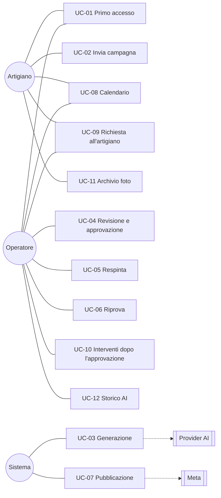
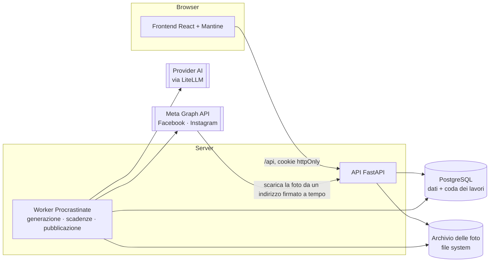
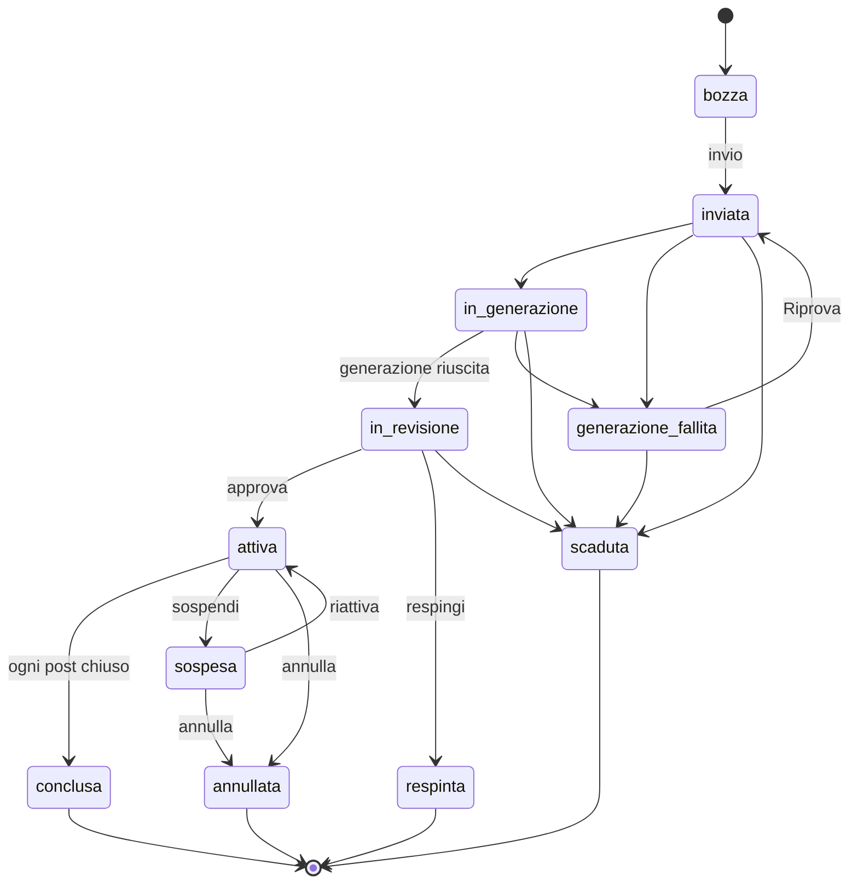
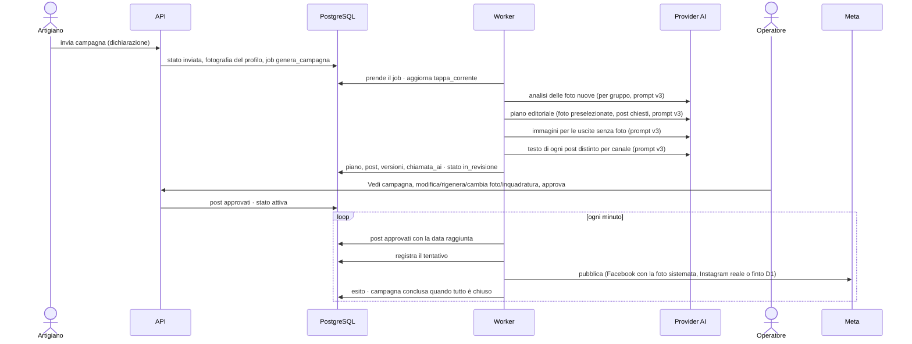
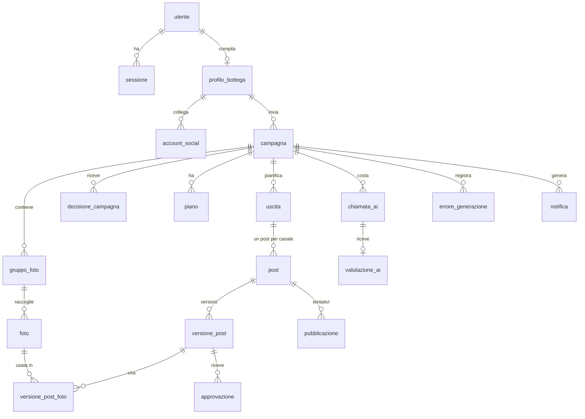

# AdFlow Suite · Proposta tecnica

**Per**: Consorzio degli artigiani · **Da**: team AdFlow (Gianluca, Silvia, Giovanni, Nilton, Angelo)
**Versione**: 1.0 del 30/10/2026 · **Perimetro**: MVP del 6 novembre 2026 (ADR-114, ADR-116…119)
**Responsabili dei capitoli**: Cap. 1 Silvia e Gianluca · Cap. 2 Giovanni e Nilton · Cap. 3 Giovanni · **Riletta da**: Angelo

## Sommario

AdFlow Suite aiuta un consorzio di botteghe artigiane a tenere vive le pagine Facebook e Instagram di ogni bottega senza chiedere all'artigiano di diventare un social media manager. L'artigiano compila una volta il profilo della bottega e, quando vuole un periodo di pubblicazioni, invia una campagna: date, canali e, se le ha, qualche foto caricata sul momento o scelta dal suo **Archivio foto**, con una breve descrizione. L'intelligenza artificiale valuta le foto, prepara il piano editoriale, scrive i testi e, se l'artigiano lo consente, crea un'immagine per i post che le foto non coprono. Un operatore del consorzio segue l'avanzamento, rivede tutto nella pagina **Vedi campagna**, sistema ciò che non va (o chiede all'artigiano fino a 3 foto sostitutive), verifica lo **Storico AI** con costi e qualità dei prompt e approva; da lì i post escono da soli, alla loro data, sulla pagina della bottega.

L'MVP consegnato il 6 novembre mostra questo percorso dal vivo, con l'AI vera (LiteLLM / OpenRouter con prompt `v3`) e la pubblicazione reale sulla Pagina Facebook di prova del consorzio (Instagram simulato secondo il ripiego D1 di `perimetro-mvp.md`). Ciò che è previsto per le fasi successive è descritto nella roadmap (capitolo 3.7).

---

## 1. Analisi dei requisiti

### 1.1 Il problema e l'obiettivo

Un artigiano sa fare il suo mestiere e lo sa raccontare a voce, ma raramente ha tempo e metodo per pubblicare con costanza: le pagine restano ferme per settimane, poi escono tre post in un giorno. Il consorzio può aiutare, ma scrivere a mano i post di decine di botteghe non è sostenibile.

**Obiettivo dell'MVP.** Dimostrare che, partendo dal profilo della bottega e da poche foto, il sistema produce un piano di post coerente con la bottega, che un operatore rivede in pochi minuti e che esce davvero sui social alla data prevista.

**Misura del risultato** (pitch e demo): una campagna di 7 giorni su due canali, inviata con meno foto dei post chiesti, arriva in revisione completa (post per canale uguali a quelli chiesti, immagini AI dove mancano le foto), viene rivista e approvata dall'operatore e pubblicata sulla pagina di prova; il costo, i prompt, le risposte e la valutazione di ogni chiamata AI sono tracciati e consultabili.

### 1.2 Attori

| Attore | Chi è | Cosa fa nell'MVP |
|---|---|---|
| **Artigiano** | Il titolare o referente della bottega | Compila il profilo della bottega (9 passi); consulta **Le mie campagne** (In corso, In lavorazione con barra di avanzamento, Passate e calendario mensile); crea e invia campagne con foto nuove o scelte dall'**Archivio foto**; sceglie se ammettere immagini AI di rimpiazzo; risponde alle richieste di foto dell'operatore; vede il calendario settimanale e mensile dei post approvati |
| **Operatore** | Personale del consorzio | Gestisce la coda **In lavorazione** (Da approvare, In corso, Storico); apre **Vedi campagna** per rivedere piano, post affiancati per canale e anteprime di pubblicazione; modifica, rigenera (su un canale o su entrambi, scegliendo anche la foto di partenza), cambia foto, regola l'inquadratura (ritaglio o bordi sfocati), sposta o chiede fino a 3 foto all'artigiano; interviene anche dopo l'approvazione; crea i nuovi artigiani; consulta e valuta lo **Storico AI** |
| **Admin** | Responsabile tecnico del consorzio | Crea gli operatori da riga di comando; nelle pagine vale come un operatore |
| **Sistema** | Il worker in background | Genera le campagne con l'AI a tappe, applica le scadenze morbide, pubblica i post alla loro data |
| **Servizi esterni** | Provider AI (tramite LiteLLM), Meta (Facebook e Instagram) | Analisi delle foto, piano editoriale, testi e immagini AI; pubblicazione sui canali social |

Un solo consorzio; canali Facebook e Instagram, solo foto.

### 1.3 Requisiti funzionali

Ogni requisito rimanda alle regole di dettaglio (R-xx) e ai criteri di accettazione (CA-xx) della specifica del progetto (`docs/agenti/spec.md`), verificati da test automatici.

| ID | Requisito | Regole | Criteri |
|---|---|---|---|
| RF-01 | Accesso con email e password; dopo l'accesso ognuno arriva alla sua pagina; la sessione scade dopo un periodo senza uso (7 giorni artigiano, 12 ore operatore) | R-29 | CA-01…03, CA-61…63 |
| RF-02 | L'operatore crea un artigiano con email e nome; la password provvisoria si mostra una sola volta | R-37 | CA-79 |
| RF-03 | Profilo della bottega in 9 passi, compilato una volta e confermato ai rientri; obbligatori segnalati | R-10 | CA-05…07 |
| RF-04 | Campagna in bozza: titolo, periodo (inizio ≥ oggi + 3 giorni, da 7 a 92 giorni), canali collegati, descrizione, scelta se lasciare creare immagini all'AI (`consenti_immagini_ai`); una sola bozza; periodi non sovrapposti | R-08, R-12, R-22, R-28 | CA-08…12, CA-48, CA-105 |
| RF-05 | Foto a gruppi con descrizione, caricate o scelte dall'Archivio foto della bottega: controllo di tipo, peso (≤ 10 MB) e lato corto (≥ 1080 px); avviso di formato fuori scala per Instagram | R-13, R-42, R-47, R-48 | CA-13, CA-91…93, CA-95, CA-109 |
| RF-06 | Riepilogo con avvisi che non bloccano (foto poche, con il numero dei post che avranno un'immagine AI; oppure blocco all'invio se l'artigiano ha vietato le immagini AI e le foto non bastano; frequenza alta) | R-25, R-28 | CA-54, CA-105 |
| RF-07 | Invio con dichiarazione obbligatoria sulle foto; all'invio si salva la fotografia del profilo, che la generazione userà sempre | R-11, R-41 | CA-14…16 |
| RF-08 | Generazione a tappe con avanzamento visibile (Analisi foto → Piano editoriale → Immagini → Testi dei post): analisi delle foto (idoneità, doppioni, punteggio, senza scartare i collage validi), piano con i post chiesti per canale, foto migliori per punteggio, immagini AI per i post scoperti, testi distinti per Facebook e Instagram validati | R-05, R-09, R-21, R-24, R-28, R-43, R-49 | CA-17…20, CA-57, CA-80, CA-110 |
| RF-09 | Errori dell'AI classificati in cinque tipi, con nuove esecuzioni automatiche o fermo in "Preparazione non riuscita" (`generazione_fallita`) e Riprova dell'operatore | R-35 | CA-19, CA-50, CA-58…60, CA-68 |
| RF-10 | Revisione: pagina **In lavorazione** con sezioni Da approvare (per urgenza), In corso e Storico; **Vedi campagna** con piano, uscite, post affiancati per canale, stati leggibili con spiegazione, blocchi e avvisi del validatore, costo AI | R-14, R-38, R-44, R-49 | CA-21, CA-69, CA-82, CA-96, CA-104 |
| RF-11 | Interventi sul post in revisione: modifica a mano (nuova versione con autore, validata), rigenerazione del testo (3 cicli per post, su questo canale o su tutti i canali dell'uscita, con scelta facoltativa della foto di partenza), cambia foto (con rigenerazione facoltativa del testo), anteprima di pubblicazione e scelta tra ritaglio centrato e bordi sfocati per le foto fuori formato, sposta data/ora | R-02…04, R-16, R-30, R-31, R-36, R-42 | CA-26…28, CA-64, CA-66, CA-71, CA-72, CA-106…109, CA-111, CA-112 |
| RF-12 | Decisione sulla campagna: approva in blocco (mai con un post bloccato) o respingi con motivo, nota e foto da rifare; email all'artigiano | R-14, R-15, R-18 | CA-21…25 |
| RF-13 | Scadenza morbida: un post non approvato in tempo scade; la campagna scade sotto la metà dei post chiesti | R-06 | CA-30 |
| RF-14 | Calendario della campagna a griglia settimanale e mensile, con clic sul post che apre il giorno o i post in Vedi campagna | R-45 | CA-56, CA-94, CA-97…103 |
| RF-15 | Richiesta all'artigiano in revisione: una domanda e fino a 3 foto da sostituire; l'artigiano risponde dalla sua pagina Campagna, con la dichiarazione per ogni foto nuova; la campagna resta in revisione | R-41, R-46 | CA-86…90 |
| RF-16 | Dopo l'approvazione: sui post che escono tra almeno 15 minuti modifica a mano (la versione nasce approvata), cambia foto, sposta, annulla con la nota; sospendi, riattiva e annulla la campagna; riprogramma un post fallito | R-16, R-33, R-34 | CA-29, CA-32, CA-67, CA-84, CA-85 |
| RF-17 | Pubblicazione automatica alla data, idempotente (al massimo un'uscita per post), con la foto sistemata per il canale (ritaglio o bordi sfocati); errori temporanei ritentati, post fallito visibile all'operatore | R-01, R-34, R-42 | CA-36…39, CA-81, CA-83 |
| RF-18 | Vista dell'artigiano (**Le mie campagne**: In corso, In lavorazione, Passate) per stato della campagna, senza mai mostrare post non approvati né note interne | §4 della specifica, R-49 | CA-31, CA-70, CA-94, CA-104 |
| RF-19 | **Storico AI** per l'operatore: ogni chiamata all'AI salvata nel database con prompt completo, risposta, modello, versione del prompt, durata, token, costo ed esito; filtri di ricerca, riepilogo numeri per versione del prompt e modello, voto 1–5 con commento e difetti riscontrati | R-44, R-50 | CA-113…115 |

### 1.4 Requisiti non funzionali

| Area | Requisito | Come si verifica |
|---|---|---|
| **Sicurezza** | Password con scrypt; sessione in cookie httpOnly, nel database solo l'hash del token; protezione CSRF same-origin attiva in produzione; permessi controllati sul server a ogni richiesta (401, 403, 404 per le risorse di altri); limite dei tentativi di accesso (5 per IP e per account ogni 15 minuti, 429); validazione HTTPS di `FOTO_URL_PUBBLICO` | Probe SAST/DAST automatici (`T3-09`), test TLS/proxy reali (`test_proxy_http_reale.py`, `#17`), `docs/sicurezza-accesso.md` e `docs/valutazione-sicurezza.md` |
| **Segreti** | Chiavi AI e token Meta solo nel file di configurazione del server, mai nel codice né nei log | `.env.example` con valori finti; test automatici sui log JSONL |
| **Privacy** | Dalle foto si toglie la posizione GPS prima della pubblicazione; dichiarazione dell'artigiano su prodotti e consenso delle persone; né dati personali né prompt/risposte AI finiscono nei log applicativi | CA-81, CA-113; test dei log |
| **Integrità** | Nulla si cancella nelle campagne inviate: versioni dei post, piani, decisioni ed errori restano; la foto originale non si modifica mai | Invarianti della costituzione; test automatici |
| **Affidabilità** | Generazione ripresa dalla tappa interrotta; pubblicazione registrata prima della chiamata al social, al massimo un esito positivo per post; campagne ferme da 30 minuti portate in errore | CA-36, CA-50, CA-68 |
| **Controllo dei contenuti** | Validatore a regole su ogni testo (blocchi: prezzi o premi non nei dati, parole vietate, limiti della piattaforma; avvisi: limiti editoriali); immagini AI senza prodotti finiti, persone, testi o marchi, e dichiarate nel post | CA-18, CA-57 |
| **Costi e osservabilità AI** | Ogni chiamata all'AI registra tipo, modello, versione del prompt, prompt, risposta, durata e costo stimato; totale per campagna e storico globale con voti 1–5 visibili all'operatore | CA-82, CA-113…115 |
| **Prestazioni** | Generazione di una campagna di 7 giorni in circa un minuto; pagine sotto il secondo in rete locale | Prova T3-32 (~1 min 18 s per 10 post) e demo reale T3-927 (~46 s per 6 post + 1 immagine AI) |
| **Usabilità** | Interfaccia in italiano con palette artigianale ("Bottega calda"), contrasto WCAG AA verificato, etichette di stato leggibili con spiegazione, uso da telefono per l'artigiano | Prova di usabilità con due persone (`T3-86`) e verifica pagine statiche (`T3-926`) |
| **Manutenibilità** | Moduli con confini controllati da un test; ogni servizio esterno dietro un adattatore con un'implementazione finta; **1.997 test** su PostgreSQL reale; controlli automatici a ogni modifica | `test_confini.py`; GitHub Actions |
| **Portabilità** | Stessi comandi su Windows, macOS e Linux | `uv run`, `allinea.py` |

### 1.5 Casi d'uso

**UC-01 · Primo accesso di una nuova bottega.** L'operatore crea l'artigiano con email e nome e gli comunica la password provvisoria (vista una sola volta). L'artigiano entra, compila i 9 passi del profilo e arriva alla pagina Le mie campagne. *Alternativa*: email già usata → l'operatore riceve un errore.

**UC-02 · Invio di una campagna.** L'artigiano conferma il profilo (Bentornato), sceglie titolo, periodo, canali e se consentire immagini AI di rimpiazzo, carica le foto a gruppi o le seleziona dal suo **Archivio foto**, legge il riepilogo con gli avvisi (per esempio quanti post per canale avranno un'immagine AI, o l'avviso di formato per foto molto larghe/alte), spunta la dichiarazione e invia. *Alternative*: inizio troppo vicino o durata fuori limite → rifiutato con il motivo; immagini AI disattivate e foto insufficienti → invio bloccato con indicazione delle foto mancanti; dichiarazione mancante o gruppo senza descrizione → invio rifiutato.

**UC-03 · Generazione.** Il sistema aggiorna la tappa corrente per la barra di avanzamento, analizza le foto nuove (riutilizzando l'analisi di quelle già idonee dall'archivio), scarta quelle non idonee o doppie con il motivo, sceglie le migliori fino ai post chiesti, chiede all'AI il piano, crea un'immagine per ogni uscita senza foto (la stessa sui due canali), scrive testi distinti per Facebook e Instagram, li valida e passa la campagna in revisione. *Alternative*: errore temporaneo → riprova da solo fino a 3 volte; errore di configurazione → generazione fallita subito; foto rifiutata dal provider → la foto resta fuori e si continua.

**UC-04 · Revisione e approvazione.** L'operatore apre la campagna dalla coda **In lavorazione**, legge piano, costo AI e post affiancati per canale; corregge un testo a mano o lo fa riscrivere all'AI (su quel canale o su entrambi, scegliendo se partire dal testo attuale o dalla foto), cambia una foto (con rigenerazione facoltativa del testo), controlla l'anteprima di pubblicazione e imposta i bordi sfocati se il ritaglio taglia il soggetto, o sposta un post; approva. I post diventano "In programma" (`approvato`) e la campagna "In corso" (`attiva`). *Alternative*: un post con un blocco del validatore impedisce l'approvazione finché non è sistemato; manca qualcosa che può dare solo l'artigiano → UC-09.

**UC-05 · Respinta.** L'operatore respinge con motivo (foto, altro), nota e foto da rifare. L'artigiano riceve l'email e lo stesso messaggio nella pagina Campagna; crea una nuova campagna riutilizzando dall'Archivio foto le immagini già idonee.

**UC-06 · Riprova di una generazione fallita.** L'operatore legge tipo, messaggio, tappa e canale dell'errore e preme Riprova: la generazione riparte dalla tappa interrotta senza rifare ciò che è salvato.

**UC-07 · Pubblicazione.** Ogni minuto il sistema pubblica i post approvati arrivati alla loro data, sulla pagina Facebook e sull'account Instagram, con la foto sistemata nel formato del canale (ritaglio centrato o bordi sfocati). *Alternative*: errore temporaneo → ritentato; errore definitivo → post "Non pubblicato" (`fallito`), notifica agli operatori; quando ogni post è chiuso la campagna è "Conclusa".

**UC-08 · Calendario.** Dopo l'approvazione l'artigiano e l'operatore leggono, nella vista settimanale o mensile, i post in programma, pubblicati o non pubblicati, con ora, canale, testo e miniatura della foto; un clic apre il dettaglio del giorno o il post in Vedi campagna.

**UC-09 · Richiesta all'artigiano.** In revisione l'operatore scrive una domanda e segna fino a 3 foto da sostituire. L'artigiano entra, la pagina Campagna gli mostra la richiesta (mai piano e post), carica una foto nuova per ogni foto segnata con la dichiarazione e invia, con una risposta se serve. L'operatore usa le foto nuove con Cambia foto e approva. *Alternative*: l'artigiano non risponde → l'operatore cambia la foto con un'altra del gruppo, oppure respinge; la richiesta non blocca mai l'approvazione.

**UC-10 · Interventi dopo l'approvazione.** Un prezzo sbagliato, un prodotto esaurito, una foto contestata: l'operatore modifica, cambia foto, sposta o annulla (con la nota) un post che esce tra almeno 15 minuti, senza fermare la campagna. Se la bottega si ferma, sospende la campagna e la riattiva dopo, scegliendo quali post arretrati pubblicare subito. *Alternative*: il post esce entro 15 minuti → non si tocca più; un post fallito si riprogramma.

**UC-11 · Gestione dell'Archivio foto.** L'artigiano consulta nella pagina **Archivio foto** tutte le foto caricate dalla bottega con descrizione, campagna d'origine e stato d'uso; elimina quelle caricate per sbaglio se non appartengono a campagne già inviate; le seleziona nella bozza di una nuova campagna senza ricaricare i file.

**UC-12 · Consultazione e valutazione dello Storico AI.** L'operatore apre **Storico AI**, filtra le chiamate per campagna, tipo, modello, versione del prompt, esito o intervallo di date, ispeziona prompt e risposta completi, confronta i numeri medi (durata, costo, tasso d'errore e voto medio per versione del prompt) e assegna un voto da 1 a 5 stelle con commento e difetti riscontrati.

### 1.6 Fuori dal perimetro dell'MVP

Non si costruiscono nell'MVP e sono descritti nella roadmap (capitolo 3.7): metriche di engagement da Meta Insights, collegamento OAuth degli account social di ogni singola bottega, caroselli multi-foto, ritocco delle foto con l'AI, immagini chieste dall'artigiano sul singolo post, pagina Artigiani e anagrafica estesa per l'operatore, promemoria automatici, richiesta all'artigiano con link da telefono senza password, abbonamenti e fatturazione. Alcune funzioni sono già scritte e testate ma nascoste nell'interfaccia ("congelate", ADR-114): si riattivano senza riscriverle.

---

## 2. Architettura, schema dati e stack

### 2.1 Vista d'insieme

Un **monolite a moduli con un worker**: lo stesso codice Python gira come API web e come processo in background, con un solo database PostgreSQL, che fa anche da coda dei lavori. Nessun servizio in più da installare o pagare.

### 2.2 Componenti

**Backend** (`backend/app/`): la composizione (`main.py`, `worker.py`, `cli.py`) conosce tutti i moduli; ogni modulo ha router (HTTP), service (logica), modelli (tabelle), schemi (contratti delle API), domain (stati e valori ammessi) e, dove servono, i job.

| Modulo | Responsabilità |
|---|---|
| `accesso` | Utenti, password, sessioni, ruoli, limite dei tentativi |
| `notifiche` | Notifiche agli operatori e all'artigiano, email |
| `artigiani` | Profilo della bottega, canali collegati, nuovo artigiano |
| `campagne` | Bozza, gruppi, archivio foto della bottega, invio e Riprova, stato e tappa della campagna, sistemazione delle foto (ritaglio o bordi sfocati), richiesta all'artigiano, vista dell'artigiano |
| `contenuti` | Generazione con l'AI a tappe, piano, uscite, post e versioni, validatore, storico e valutazione delle chiamate AI (`chiamata_ai`, `valutazione_ai`), calendario |
| `revisione` | Campagne da approvare e in lavorazione, Vedi campagna, interventi sul post (in revisione e dopo l'approvazione), approva, respingi, sospendi, riattiva e annulla, scadenze |
| `pubblicazione` | Pubblicazione dei post dovuti, tentativi ed esiti |

I moduli seguono quest'ordine e un modulo usa solo il service di quelli che lo precedono; un test automatico (`test_confini.py`) lo controlla. Lo stato di una campagna cambia solo nel modulo `campagne`, quello di un post solo in `contenuti`, e ogni passaggio è controllato contro le transizioni ammesse.

`core/` offre a tutti configurazione, connessione al database, coda, errori, orologio iniettabile (per i test e per le prove "nel futuro"), sicurezza (CSRF same-origin, eventi JSON su stderr) e limiti delle richieste.

**Frontend** (`frontend/src/`): React con TypeScript e Mantine (tema artigianale "Bottega calda"); un file di API per modulo, con i tipi che rispecchiano gli schemi del backend; pagine dell'artigiano (**Le mie campagne**, **Nuova campagna**, **Archivio foto**, **Profilo**) e dell'operatore (**In lavorazione**, **Vedi campagna**, **Nuovo artigiano**, **Storico AI**). Per lavorare senza backend ci sono dati di esempio con la stessa forma delle API.

### 2.3 Flussi principali

**Stati della campagna nell'MVP**

Il vecchio stato `piano_da_rivedere` esiste nel codice per compatibilità ma nell'MVP nessuna campagna nuova ci arriva. La richiesta all'artigiano non è uno stato: la campagna resta `in_revisione`. Nell'interfaccia ogni stato è accompagnato da un'etichetta leggibile e da una spiegazione al passaggio del mouse (es. «In coda», «L'AI la prepara», «Da rivedere», «In corso»).

**Stati del post**: `da_approvare` → `approvato` → `pubblicato`, `fallito` o `annullato`; `da_approvare` → `scaduto` o `scartato` (campagna respinta o annullata). "Da rivedere" non è uno stato ma un'indicazione: la versione corrente ha un blocco del validatore.

**Dall'invio alla pubblicazione**

La **generazione va a tappe** (`analisi`, `piano`, `immagini`, `testi`), ognuna salvata prima della successiva e mostrata nella barra di avanzamento: un'interruzione o una Riprova ripartono dalla prima tappa non fatta, senza ripagare le chiamate già fatte. Il **piano** ha sempre esattamente i post chiesti: post a settimana × giorni ÷ 7, per canale. Se le foto idonee sono di più, il codice passa all'AI solo le migliori per punteggio; se sono di meno e l'artigiano lo consente, i post scoperti hanno un'immagine creata dall'AI. Il piano dell'AI passa un controllo a regole (post per canale, nessuna foto ripetuta sullo stesso canale, date nel periodo e non nel passato) e si fa riscrivere fino a 3 volte.

### 2.4 Adattatori

Ogni servizio esterno sta dietro un'interfaccia con due implementazioni: una vera e una finta, usata nei test e in sviluppo. Nessun test chiama servizi reali.

| Adattatore | Interfaccia | Reale | Finto |
|---|---|---|---|
| **AI** | `analizza_gruppo()`, `pianifica_campagna()`, `genera_post()`, `genera_immagine()`; ogni chiamata restituisce anche prompt, risposta, durata e uso per il costo; errori tradotti in 5 tipi (`temporaneo`, `risposta`, `configurazione`, `richiesta`, `rifiuto`) | LiteLLM con modelli Pydantic validati e prompt versionati (`v3`); provider OpenRouter/OpenAI (`gpt-4o` per visione e testo, `gpt-5-image-mini` per le immagini) | Risposte prevedibili e distinte per canale, errori di ogni tipo a comando |
| **Social** | `pubblica(canale, testo, hashtag, foto, indirizzo della foto)` → esito `ok`, `temporaneo` o `definitivo` | Meta Graph API (`v22.0`): Facebook `POST /{page-id}/photos` sulla Pagina di prova del team; Instagram `POST /{ig-id}/media` e `POST /{ig-id}/media_publish` (con ripiego automatico sul finto quando `META_INSTAGRAM_ID` è vuoto, D1) | Esiti a comando |
| **Email** | `invia()` | SMTP verso un catcher locale (Mailpit) o server SMTP transazionale | In memoria |
| **Archivio** | salva, legge, elimina file con nome generato dal server | File system (`ARCHIVIO_FOTO_DIR`) | Cartella temporanea |

Instagram accetta solo foto JPEG raggiungibili da un indirizzo pubblico: l'API espone `GET /foto/{id}/pubblica` con una firma HMAC a tempo.

### 2.5 Schema dati

| Tabella | Contenuto essenziale |
|---|---|
| `utente`, `sessione`, `limite_login` | Account con ruolo; sessioni con l'hash del token e la scadenza; contatori dei tentativi di accesso |
| `profilo_bottega`, `account_social` | Profilo in 9 passi (identità, prodotti, pubblico, tono, vincoli, frequenza, foto, eventi); stato del collegamento per canale |
| `campagna` | Periodo, canali, stato, `tappa_corrente`, `consenti_immagini_ai`, frequenza e obiettivo, **fotografia del profilo** all'invio (con la dichiarazione), richiesta all'artigiano, date di invio e chiusura |
| `gruppo_foto`, `foto` | Gruppi con descrizione e data indicativa; foto con file originale, dimensioni, `inquadratura` (`ritaglio` o `bordi`), analisi dell'AI (idonea, doppione, punteggio, motivo), origine (`caricata` o `creata_ai`) |
| `piano`, `uscita`, `post` | Piano dell'AI con strategia ed esito del controllo; uscite (tema, gruppo); post per canale con data, stato, rimpiazzo `immagine_ai`, indicazione "da rivedere", cicli di rigenerazione |
| `versione_post`, `versione_post_foto` | Ogni versione del testo con autore (AI o operatore), tipo di intervento, esito del validatore e foto |
| `decisione_campagna`, `approvazione` | Approvazioni e respinte con motivo, nota e foto segnate |
| `chiamata_ai`, `valutazione_ai`, `errore_generazione` | Tracciamento di ogni chiamata all'AI (tipo, modello, versione prompt, prompt, risposta, durata, token, immagini, esito, costo stimato); valutazione dell'operatore (voto 1–5, commento, difetti); errori di generazione con tipo, tappa e canale |
| `pubblicazione` | Tentativi per post, con un indice parziale unico che ammette un solo esito positivo per post |
| `notifica` | Notifiche e stato dell'invio dell'email |
| `procrastinate_*` | Coda dei lavori della libreria Procrastinate |

Le tabelle nascono con una catena di **13 migrazioni Alembic** (`001`–`013`); date in UTC, fuso `Europe/Rome` solo per orari editoriali, filtri data e scadenze.

### 2.6 API dell'MVP

Tutte sotto `/api`, in JSON, errori come `{"detail": "messaggio in italiano"}` con 401, 403, 404, 409, 413, 422 e 429.

| Area | Endpoint |
|---|---|
| Accesso | `POST /auth/login` · `POST /auth/logout` · `GET /auth/me` · `GET /consorzio` · `GET /health` |
| Artigiani | `GET /canali` · `GET`, `PUT /profilo` · `POST /artigiani` (nuovo artigiano) |
| Campagne e Foto | `GET`, `POST /campagne` · `GET`, `PATCH /campagne/{id}` · gruppi e foto della bozza · `GET /foto` (archivio bottega) · `DELETE /foto/{id}` · `POST /campagne/{id}/gruppi/{gid}/foto-da-archivio` · `GET /foto/{id}/file` · `GET /foto/{id}/anteprima` · `POST /foto/{id}/inquadratura` · `POST /campagne/{id}/invia` · `POST /campagne/{id}/riprova` · `GET /foto/{id}/pubblica` (firmato, per Instagram) · `POST /campagne/{id}/richiesta` · `POST /campagne/{id}/richiesta/foto` · `POST /campagne/{id}/richiesta/invia` |
| Revisione | `GET /da-approvare` · `GET /campagne/{id}/post` · `POST /campagne/{id}/approva` · `POST /campagne/{id}/respingi` · `POST /campagne/{id}/sospendi` · `POST /campagne/{id}/riattiva` · `POST /campagne/{id}/annulla` · `POST /post/{id}/modifica` · `POST /post/{id}/rigenera` · `GET /post/{id}/foto-possibili` · `POST /post/{id}/cambia-foto` · `POST /post/{id}/sposta` · `POST /post/{id}/annulla` · `POST /post/{id}/riprogramma` |
| Contenuti e Storico AI | `GET /campagne/{id}/calendario` · `GET /storico-ai` · `GET /storico-ai/numeri` · `GET /storico-ai/{id}` · `POST /storico-ai/{id}/voto` |

La documentazione interattiva completa è generata da FastAPI (`/docs`).

### 2.7 Stack e motivazioni

| Scelta | Perché |
|---|---|
| **Python 3.11 + FastAPI + Pydantic** | Tipi e validazione dei dati nello stesso linguaggio dell'AI; documentazione delle API automatica; il team lo conosce dal corso |
| **PostgreSQL 16** | Un solo database affidabile per dati, JSON (profilo, analisi, piani) e coda dei lavori; vincoli e indici parziali garantiscono le regole critiche (un solo esito positivo per post) |
| **SQLAlchemy 2 + Alembic** | Modelli tipizzati e 13 migrazioni versionate, provate a ogni esecuzione dei test |
| **Procrastinate** | Coda e job periodici dentro PostgreSQL: niente Redis o broker in più da gestire e pagare |
| **LiteLLM** | Un'unica interfaccia verso più provider AI: si cambia modello o fornitore con una riga di configurazione, e l'uso di ogni chiamata è restituito per il calcolo del costo |
| **Meta Graph API** | Unica strada ufficiale per pubblicare su Pagine Facebook e account Instagram professionali; un solo token della Pagina copre entrambi i canali |
| **Pillow** | Sistemazione locale delle foto (rotazione EXIF, GPS tolto, ritaglio centrato o bordi sfocati su sfondo della foto, 1080 px, JPEG) senza costi né invio a terzi |
| **React + TypeScript + Vite + Mantine** | Componenti pronti e accessibili, tema personalizzato coerente con le pagine statiche, tipi condivisi con le API, build veloce |
| **pytest su PostgreSQL reale** | I test provano davvero vincoli, transazioni e migrazioni (**1.997 test automatici**) |
| **uv, black, oxlint, GitHub Actions** | Stessi comandi su ogni sistema; formattazione, probe di sicurezza e controlli automatici a ogni modifica |

### 2.8 Sicurezza e dati personali

- Password con scrypt; token di sessione casuale nel cookie httpOnly `adflow_sessione` (`SameSite=Lax`, `Path=/`), nel database solo il suo hash; cookie `Secure` obbligatorio in produzione (`COOKIE_SECURE=false` rifiutato).
- Protezione CSRF same-origin in produzione su tutte le richieste mutanti (`POST`, `PUT`, `PATCH`, `DELETE`).
- Permessi sul server a ogni richiesta; l'artigiano vede solo le sue campagne e le sue foto (404 sulle altrui).
- Limite di 5 tentativi di accesso per IP e per account in 15 minuti, condiviso tra processi su PostgreSQL; richieste oltre 12 MiB rifiutate prima del router.
- Upload: tipo reale del file (magic bytes), peso e dimensioni controllati; nome del file generato dal server.
- Foto pubblicate senza posizione GPS; indirizzo pubblico della foto firmato con HMAC e a tempo, con validazione HTTPS obbligatoria di `FOTO_URL_PUBBLICO` in produzione.
- Segreti (chiave AI, token Meta, segreto HMAC) solo nella configurazione del server; eventi di sicurezza registrati in JSON su stderr senza dati personali; prompt e risposte dell'AI salvati solo nel database e mai nei log.

### 2.9 Ambienti

| Ambiente | Come |
|---|---|
| Sviluppo | Ogni membro del team in locale: PostgreSQL, API, worker, frontend; AI e social finti; email al catcher locale (Mailpit) |
| Test | Database `adflow_test` verificato a ogni esecuzione; GitHub Actions rilancia probe di sicurezza, migrazioni, test e formattazione a ogni pull request |
| Demo (6 novembre) | Server locale del team con AI vera (`AI_PROVIDER=litellm`), Pagina Facebook di prova (`SOCIAL_PROVIDER=meta`) e Mailpit; dati preparati con un comando da database vuoto (`T3-06`) |
| Esercizio (dopo l'MVP) | Un server europeo con API, worker e PostgreSQL dietro reverse proxy HTTPS (Nginx); vedi capitolo 3.5 |

---

## 3. Piano, costi e tempi

### 3.1 Metodo

Lavoro in sprint brevi, ognuno con task piccoli, un branch e una pull request per task, rivista da un collega e unita dall'amministratore del repository. Le regole del prodotto, l'architettura e i task stanno in una sola documentazione (`docs/agenti/`), usata sia dalle persone sia dagli assistenti AI di sviluppo. Ogni criterio di accettazione (CA-01…CA-116) ha almeno un test automatico; la chiusura dello sprint è il percorso completo provato da database vuoto.

### 3.2 Milestone

| Milestone | Periodo | Contenuto | Stato |
|---|---|---|---|
| M0 · Avvio | 25–28/09/2026 | Analisi, decisioni architetturali, prime pagine statiche, struttura del repository | Fatto |
| M1 · Scheletro che cammina (sprint 1) | 28/09–10/10 | Modello dati, accesso, bozza e invio, generazione con AI finta, revisione minima, pubblicazione simulata, frontend minimo | Fatto |
| M2 · Profilo e campagna (sprint 2a) | 10/10 | Pagine Profilo e Campagna complete, modifica della bozza | Fatto |
| M3 · Revisione e sicurezza (sprint 2b) | 12–13/10 | Interventi sul post, decisioni, scadenze, notifiche, limite login e sicurezza accesso | Fatto |
| M4 · Perimetro MVP | 13–14/10 | Decisione ADR-114, codice tolto e congelato, pagine statiche allineate | Fatto |
| M5 · AI vera e immagini | 14–20/10 | Adattatore LiteLLM, prova empirica su 10 post e scelta di GPT-4o (`T3-32`), generazione MVP e immagini AI (`T3-33`, `T3-34`) | Fatto |
| M6 · Meta e foto | 14–23/10 | Pagina di prova, sistemazione foto e URL firmato, adattatore Meta (`T3-42`), pubblicazione reale su Facebook e ripiego D1 per Instagram (`T3-43`) | Fatto |
| M7 · Interventi, pagine, interfaccia e richieste | 21–30/10 | Corsia 6 (ADR-116: richiesta all'artigiano e interventi post-approvazione), Corsia 7 (ADR-117: Archivio foto, elenchi campagne e calendario mensile), Corsia 8 (ADR-118: restyling "Bottega calda" e prova d'uso), Corsia 9 (ADR-119: stati leggibili, prompt `v3`, rigenerazione multi-canale, bordi sfocati, Storico AI e demo reale `T3-927`) | Fatto |
| M8 · Codice bloccato e chiusura | 30/10 | Sistemazione definitiva (`T3-08`), proposta tecnica v1.0 (`T3-02`), pitch (`T3-05`), percorso di chiusura e video di riserva (`T3-07`) | Fatto |
| M9 · Consegna e pitch | 02–06/11 | Prove di presentazione del team; pitch finale il 06/11/2026 | Pronto |

### 3.3 Ore del team

Team di 5 persone (Gianluca, Silvia, Giovanni, Nilton, Angelo), dal 25/09 al 06/11/2026 (6 settimane, 37 ore settimanali per componente = 222 ore a persona).

| Milestone | Task completati | Ore effettive del team |
|---|---|---|
| M0 · Avvio (analisi, ADR, pagine statiche iniziali) | — | 60 |
| M1 · Sprint 1 (scheletro end-to-end) | 28 | 250 |
| M2 · Sprint 2a (profilo e bozza campagna) | 12 | 95 |
| M3 · Sprint 2b + follow-up di sicurezza (#16–19, #39–41, #44–45) | 18 + 9 | 195 |
| M4 · Perimetro MVP (T3-01, T3-03) | 2 | 30 |
| M5–M7 · Sprint 3 MVP (corsie 0–9: AI, Meta, foto, interventi, pagine, interfaccia, storico AI) | 70 | 400 |
| M8–M9 · Chiusura, proposta tecnica, pitch e prove | 4 | 80 |
| **Totale** | **143** | **1.110 ore** |

Ripartizione per componente (6 settimane):
- **Gianluca** (Artigiani, calendario, revisione, requisiti Cap. 1): 222 ore
- **Silvia** (Campagne, foto, sistemazione immagini, requisiti Cap. 1): 222 ore
- **Giovanni** (Architettura, AI e prompt, pagine statiche, coordinamento proposta e pitch): 222 ore
- **Nilton** (Pubblicazione, Meta Graph API, worker e job): 222 ore
- **Angelo** (Frontend React/Mantine, usabilità, revisione deliverable): 222 ore

### 3.4 Costi di sviluppo

| Voce | Calcolo | Importo |
|---|---|---|
| Lavoro del team | 1.110 ore × tariffa oraria junior di 30 €/ora | 33.300 € |
| Assistenti AI di sviluppo | 5 abbonamenti × 1,5 mesi × 20 € | 150 € |
| Credito AI per sviluppo, benchmark T3-32 e demo reali (T3-925, T3-927) | Budget stanziato sul provider OpenRouter (consumo effettivo < 15 $) | 50 € |
| Meta Graph API, GitHub, librerie open source | Piani gratuiti; licenze MIT, BSD, Apache 2.0 | 0 € |
| **Totale costo di sviluppo MVP** | | **33.500 €** |

### 3.5 Costi di esercizio

**AI.** Il modello adottato per l'MVP è **GPT-4o** (via OpenRouter/LiteLLM: `openrouter/openai/gpt-4o` per visione e testo; `openrouter/openai/gpt-5-image-mini` per le immagini), validato con il benchmark su 10 post (`T3-32`) e con la demo reale completa (`T3-925` e `T3-927`, prompt `v3`).
Costo medio misurato per chiamata:
- **Analisi foto**: ≈ 0,008 $ per foto con GPT-4o (≈ 0,025 $ per un gruppo di 3 foto nella demo reale `T3-927`; ≈ 0,072 $ per un gruppo di 9 foto nel benchmark `T3-32`).
- **Piano editoriale**: ≈ 0,007–0,011 $ per piano.
- **Generazione testo post (`v3`)**: ≈ 0,0025–0,0045 $ per post.
- **Immagine AI di rimpiazzo (`gpt-5-image-mini`)**: ≈ 0,030 $ per immagine quadrata 1:1.

Il costo di una campagna è la somma delle sue chiamate, tutte registrate in `chiamata_ai` (R-44, R-50):

> costo campagna = gruppi di foto nuove × costo analisi + costo piano (con le riscritture) + post × costo testo (con le rigenerazioni) + uscite senza foto × costo immagine

| Scenario | Chiamate | Costo misurato per campagna |
|---|---|---|
| **Demo reale MVP (`T3-927`)**: 7 giorni, 3 post/settimana, 2 canali (6 post), 2 foto idonee + 1 uscita con immagine AI + 1 rigenerazione | 1 analisi (3 foto), 1 piano, 7 testi, 1 immagine AI | **0,0781 $** (≈ 0,07 €) |
| **Benchmark 10 post (`T3-32`)**: 7 giorni, 5 post/settimana, 2 canali (10 post), 9 foto nuove | 1 analisi (9 foto), 1 piano, 10 testi, 0 immagini AI | **≈ 0,13 $** (≈ 0,12 €) |
| **Campagna mensile con foto**: 4 settimane, 3 post/settimana, 2 canali (24 post), 12 foto (in parte da Archivio foto) | 1–2 analisi, 1 piano, 24 testi, 0 immagini AI | **≈ 0,15–0,21 $** |
| **Campagna mensile senza foto**: 4 settimane, 3 post/settimana, 2 canali (24 post), 12 immagini AI | 0 analisi, 1 piano, 24 testi, 12 immagini AI | **≈ 0,42–0,55 $** |

Per un consorzio di **50 botteghe** con una campagna di 4 settimane al mese ciascuna (3 post/settimana su 2 canali): **≈ 10–15 $/mese** con le foto della bottega (ancora meno riutilizzando le foto già analizzate dall'Archivio foto) oppure **≈ 22–28 $/mese** se tutte usano immagini AI. Il tetto di spesa si imposta sul conto del provider; l'operatore controlla in tempo reale il costo di ogni campagna e il riepilogo globale nella pagina **Storico AI**.

**Hosting.**

| Voce | Configurazione di riferimento | Costo mensile |
|---|---|---|
| Server (API, worker, PostgreSQL) | VPS cloud europeo (es. Hetzner CX22 / OVH, 2 vCPU, 4 GB RAM, 40 GB NVMe) | 6 € |
| Archivio delle foto e backup | Storage aggiuntivo e snapshot giornalieri automatici | 4 € |
| Dominio e certificato HTTPS | Dominio `.it` annuale; certificato TLS gratuito (Let's Encrypt) | 1 € |
| Email transazionali (dopo l'MVP) | Servizio SMTP europeo, fascia fino a 10.000 email/mese | 5 € |
| Meta Graph API | Gratuita | 0 € |
| **Totale hosting (escluso consumo AI)** | | **16 €/mese** |

Con 50 botteghe attive, il costo vivo totale di infrastruttura + intelligenza artificiale è di **circa 25–40 €/mese** (meno di **0,80 € al mese per bottega**).

### 3.6 Rischi e mitigazioni

| Rischio | Effetto | Mitigazione attuata |
|---|---|---|
| Instagram richiede verifiche aggiuntive sull'account collegato | Pubblicazione live solo su Facebook | Configurazione Meta completata; **Facebook pubblica dal vivo** sulla Pagina di prova (`T3-927`), mentre Instagram usa il ripiego simulato automatico previsto da D1 (`META_INSTAGRAM_ID` vuoto) |
| Qualità dei testi o delle immagini dell'AI | Più lavoro per l'operatore | Prompt `v3` con testi distinti per canale e regole anti-ripetizione; validatore a regole; modifica a mano, rigenerazione su uno o tutti i canali, scelta della foto di partenza e valutazione 1–5 nello Storico AI |
| Foto degli artigiani con proporzioni incompatibili con Instagram | Soggetto tagliato male | Controllo delle proporzioni al caricamento (`CA-109`), anteprima dell'inquadratura in Vedi campagna e opzione **bordi sfocati** ricavati dalla foto stessa (`CA-111`, `CA-112`) |
| Costo dell'AI fuori controllo | Spesa imprevista | Costo, token e durata di ogni chiamata registrati in `chiamata_ai` e aggregati in `GET /storico-ai/numeri`; tetto sul conto del provider |
| Errori del provider AI durante la demo | Generazione ferma | Errori classificati in 5 famiglie con retry automatico e pulsante Riprova; video di riserva della demo registrato (`T3-07`) |
| Foto non della bottega o persone senza consenso | Rischio legale e di reputazione | Dichiarazione obbligatoria all'invio e per ogni foto nuova; cambia foto e richiesta all'artigiano in revisione; dopo l'approvazione il singolo post si cambia o si annulla; immagini AI senza prodotti finiti o persone e dichiarate nel post |

### 3.7 Dopo l'MVP

Dalla roadmap (`docs/ROADMAP.md`), in ordine di priorità:

1. **Riattivazione immediata del codice congelato** (già scritto e testato): spunta di revisione per singolo post, nota interna per post, rimozione di un canale dalla campagna; caroselli da 2 a 4 foto; suggerimento automatico di foto dall'archivio della bottega nel piano.
2. **Metriche di engagement** per post, campagna e canale (copertura, interazioni, clic da Meta Insights), con pagina **Metriche** (anteprima già pronta in `docs/pagine/AdFlow-metriche.html`), report settimanale e orari scelti dai dati storici.
3. **Collegamento OAuth degli account social** di ogni bottega con Advanced Access e App Review di Meta; sospensione automatica se un permesso scade.
4. **Pagine operatore di gestione**: ingresso con quadro del consorzio, elenco artigiani (`AdFlow-operatore-artigiani.html`) e scheda anagrafica della bottega (`AdFlow-operatore-artigiano.html`).
5. **Contenuti avanzati**: ritocco delle foto con l'AI (sfondo e luce senza toccare il prodotto), immagini chieste dall'artigiano sul singolo post, varianti per test A/B; nella richiesta all'artigiano, un link da telefono senza password e l'analisi AI immediata della foto sostitutiva.
6. **Prodotto**: abbonamento a fasce e fatturazione, approvazione facoltativa dei post da parte dell'artigiano, altri canali e formato video/Reel.

---

## Appendice

### Glossario

| Termine | Significato |
|---|---|
| Campagna | Un periodo di pubblicazioni chiesto dall'artigiano, con canali e foto |
| Uscita | Un tema del piano, che esce come un post su ogni canale della campagna |
| Post chiesti | Post a settimana × giorni della campagna ÷ 7, per canale |
| Archivio foto | Raccolta delle foto già caricate dalla bottega, riutilizzabili nelle campagne successive |
| Immagine AI | Immagine creata dall'AI per un post che le foto non coprono, dichiarata nel testo |
| Inquadratura (`ritaglio` / `bordi`) | Scelta dell'operatore su come adattare una foto fuori formato: ritaglio centrato oppure foto intera con bordi sfocati ricavati dalla foto stessa |
| Fotografia del profilo | Copia del profilo salvata all'invio, usata da generazione e rigenerazioni |
| Validatore | Controllo a regole del testo: i blocchi impediscono l'approvazione, gli avvisi no |
| Storico AI | Registro delle chiamate all'AI con prompt, risposta, durata, costo e valutazione 1–5 dell'operatore |
| Congelato | Codice che resta nel repository, testato, ma nascosto nell'interfaccia dell'MVP (ADR-114) |

### Fonti

`docs/agenti/perimetro-mvp.md` (ADR-114, ADR-116…119), `docs/agenti/spec.md` §0–§6, `docs/agenti/plan.md` §1–§6, `docs/agenti/constitution.md` §2–§3, `docs/agenti/tasks.md`, `docs/ROADMAP.md`, `docs/valutazione-sicurezza.md`, rapporti delle prove reali `qa/corsia9/T3-927/demo-reale-rapporto.md`, pagine statiche in `docs/pagine/`.

### Decisioni e parametri consolidati nella v1.0

| Voce | Esito consolidato | Data |
|---|---|---|
| Responsabili dei capitoli e revisore | Cap. 1 Silvia e Gianluca · Cap. 2 Giovanni e Nilton · Cap. 3 Giovanni · Revisore: Angelo | 30/10/2026 |
| Ore del team per sprint e totali (3.3) | 1.110 ore complessive su 6 settimane (222 ore per ciascuno dei 5 componenti, 143 task chiusi) | 30/10/2026 |
| Tariffa oraria e costo di sviluppo (3.4) | 30 €/ora (riferimento junior concordato), totale sviluppo MVP 33.500 € | 30/10/2026 |
| Modello AI, prompt `v3`, costi e tempi (1.4, 3.5) | `gpt-4o` + `gpt-5-image-mini` via OpenRouter/LiteLLM; 0,0781 $ e ~46 s nella demo reale `T3-927`, ≈ 0,13 $ e ~1 min 18 s su 10 post in `T3-32` | 14/10 e 30/10/2026 |
| Pubblicazione Meta (3.2, 3.6) | Facebook reale verificato sulla Pagina di prova (`1343384632199586`); Instagram simulato con il ripiego D1 | 23/10 e 30/10/2026 |
| Infrastruttura di hosting (3.5) | VPS cloud europeo (2 vCPU, 4 GB RAM) + storage backup + Let's Encrypt: 16 €/mese fissi (~25–40 €/mese incluso AI per 50 botteghe) | 30/10/2026 |
